# Parameters

Every setting of the generator, as OpenSCAD's Customizer shows them. The app shows each one in a
section of its settings panel (the main ones first, the rest under the section's More), under
friendlier names; the name in brackets is the one in the `.scad` file. Lengths are in mm, angles in degrees.

Where to look: the **fit on the horn** (neck, shank, bore), the **inside passage** (throat, chamber, floor,
baffle), the **reed seat** (window, rails, table, facing), the **outside** (body, beak) and the **advanced
profiles** (point lists and shape edits, last). The sections below follow the file; the app groups them a
little differently. The [guide](GUIDE.md) covers the Shape charts and Readouts.

Measuring: *from the shank end* / *from the tip* is always named; "+" and "-" on a length or height are a
**change from the preset** (0 = as the preset); a setting with no unit is a shape factor, not a dimension.

Each picture is the alto preset at two values of one setting, the rest unchanged (unless its caption says
otherwise), seen where the setting acts (a section when it acts inside):

- **gray**: in both
- **blue**: added going from the first value to the second
- **orange**: taken away going from the first value to the second

This page is made by `node scripts/param_docs.mjs` from `scad/lib/mouthpiece_base.scad`.

Sections: [Shank](#shank) · [Chamber](#chamber) · [Baffle](#baffle) · [Window](#window) · [Table](#table) · [Facing](#facing) · [Exterior](#exterior) · [Lettering](#lettering) · [Profile overrides](#profile-overrides) · [Manufacturing](#manufacturing) · [Ligature](#ligature) · [Cap](#cap) · [Output](#output)

## Shank

### Neck cork diameter (`neck_cork_diameter`)

Your neck cork's diameter (mm), measured with calipers.

Measure the cork with calipers across two directions (corks are often slightly oval) and use the
average. The socket is made this much minus **Cork squeeze**.

Not sure? Print the three shank test rings first: [Check the cork fit](PRINTING.md#1-check-the-cork-fit-15-minutes).

Range: 10 to 27, step 0.05.

Presets: Alto `16.2` · Tenor `17.2` · Bari `18.0` · Soprano `13.8`.

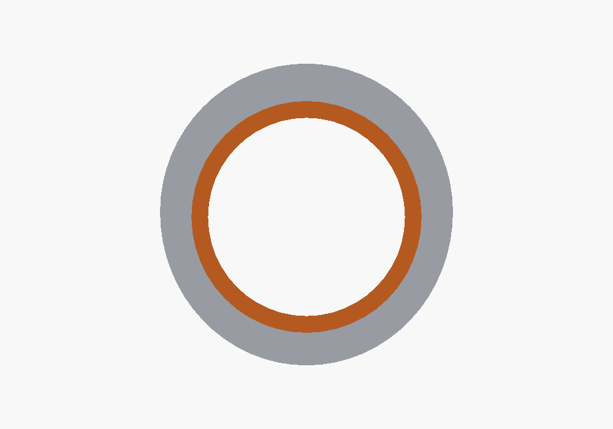

*15 → 17.5*

### Cork squeeze (`shank_clearance`)

How much smaller than your cork the socket is (mm): bigger = tighter. Try 0.1-0.3.

The socket is made this much smaller than **Neck cork diameter**, so the cork is squeezed when it
goes in: 0 = the socket is exactly the cork's size. 0.1-0.3 mm suits most corks.

The quickest way to find yours is the three shank test rings (0.10, 0.20, 0.30): see
[Check the cork fit](PRINTING.md#1-check-the-cork-fit-15-minutes).

Range: 0 to 0.6, step 0.01.

Presets: Alto `0.2` · Tenor `0.2` · Bari `0.2` · Soprano `0.2`.

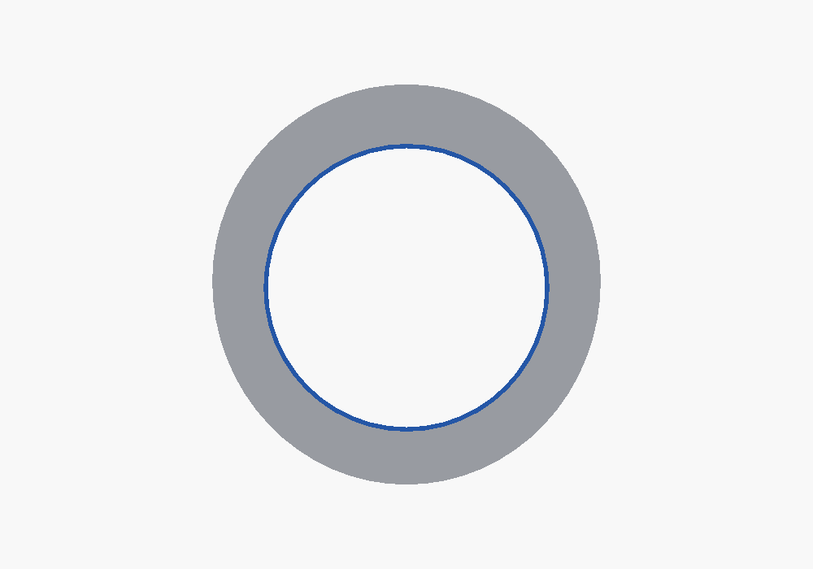

*0 → 0.5*

### Lead-in at the opening (`shank_bevel`)

How much wider the socket's mouth is, per side (mm), to ease it onto the cork.

Range: 0 to 3, step 0.1.

Presets: Alto `1.0` · Tenor `1.0` · Bari `1.0` · Soprano `1.0`.

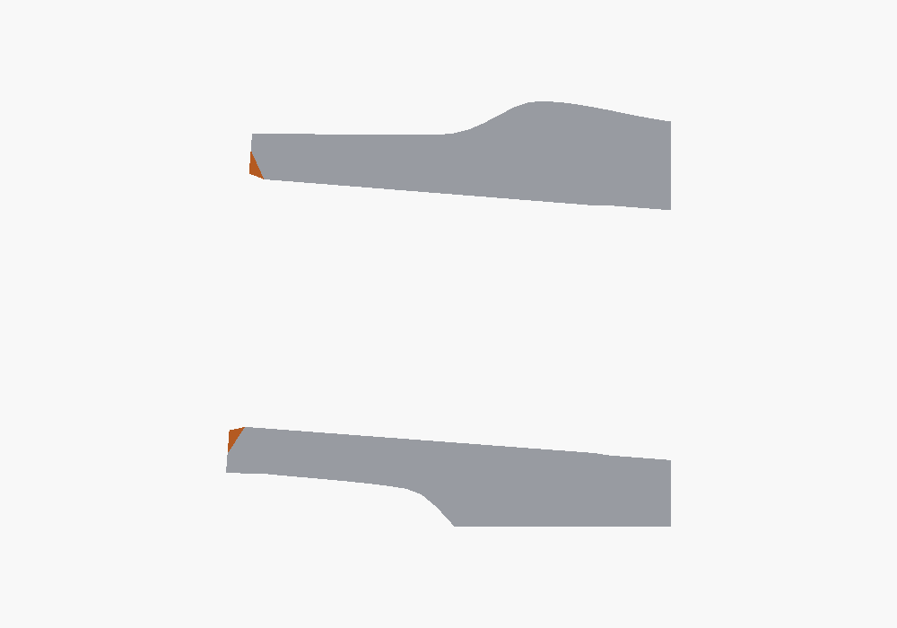

*0.3 → 1.8*

### Lead-in length (`shank_bevel_depth`)

How far in the socket's lead-in goes (mm).

Range: 0.2 to 20, step 0.1.

Presets: Alto `1.0` · Tenor `1.0` · Bari `1.0` · Soprano `1.0`.

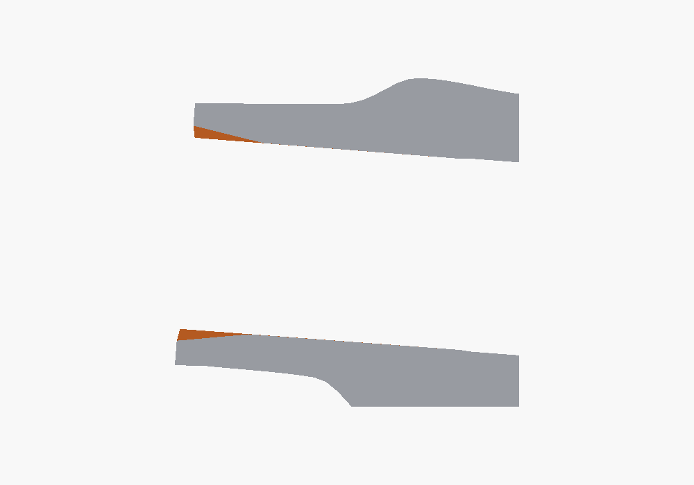

*0.2 → 6*

### How far the cork goes in (`shank_depth`)

How far the cork goes in (mm). Other settings give way to keep it.

Range: 10 to 70, step 0.5.

Presets: Alto `22.0` · Tenor `26.0` · Bari `30.0` · Soprano `25.5`.

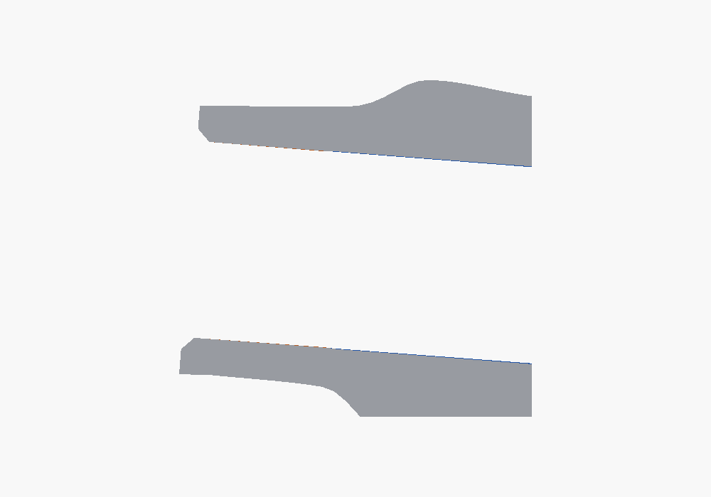

*10 → 37*

### Bore (behind the cork) (`bore_diameter`)

Diameter of the tube behind the socket (mm), about your neck tip's inside diameter.

Range: 8 to 24, step 0.1.

Presets: Alto `16.2` · Tenor `17.0` · Bari `16.9` · Soprano `13.6`.

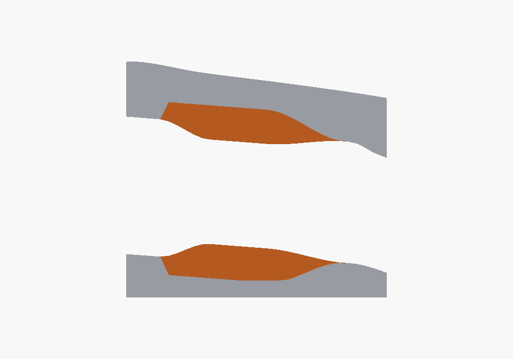

*12.2 → 20.2*

### Table angle to the neck (`bore_tilt`)

Angle between the neck's line and the reed table (degrees); about 4 is typical.

The neck goes into the mouthpiece at a slight angle to the reed table. This is that angle; about
4 degrees is typical. More tilts the table further from the neck's line.

Range: -3 to 8, step 0.1.

Presets: Alto `4.4` · Tenor `4.1` · Bari `4.8` · Soprano `4.1`.

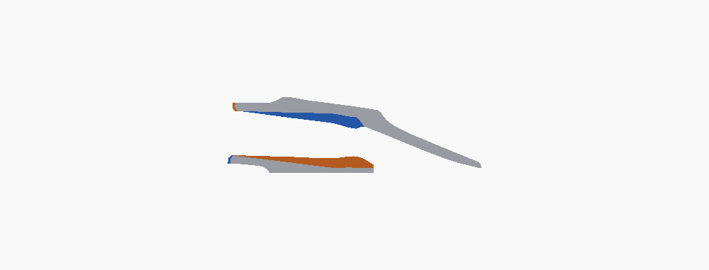

*1.7 → 7.2*

### Shank outside diameter (`shank_diameter`)

Outside diameter of the shank at the neck end (mm); grows if the wall gets too thin.

Range: 14 to 32, step 0.1.

Presets: Alto `22` · Tenor `23` · Bari `24.1` · Soprano `17.8`.

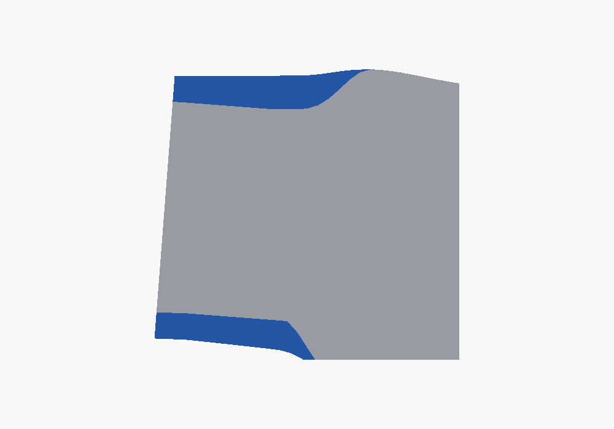

*19 → 25*

## Chamber

### Chamber shape (`chamber_shape`)

Cross-section of the chamber after the throat.

**round**: rounded sections that get boxier toward the window. **square**: rounded corners (never sharp).
**horseshoe**: a rounder upper half over a flatter lower half.

Range: `round`, `square`, `horseshoe`.

Presets: Alto `horseshoe` · Tenor `round` · Bari `round` · Soprano `square`.

*`horseshoe` (the alto's) → `round`*

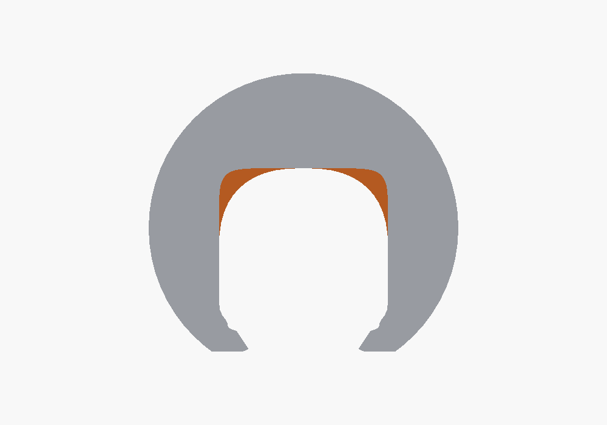

*`horseshoe` (the alto's) → `square`*

### Chamber width (`chamber_width`)

Width of the chamber after the throat (mm), whatever the throat's width.

Range: 4 to 36, step 0.1.

Presets: Alto `13.8` · Tenor `14.5` · Bari `15.4` · Soprano `9.5`.

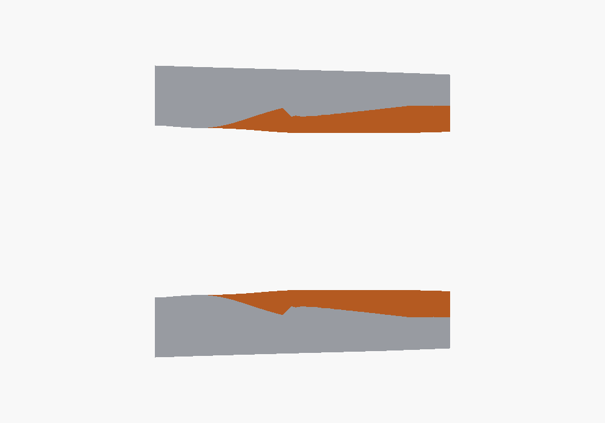

*13.2 → 18*

### Widening after the throat (`chamber_flare`)

How gradually the chamber widens after the throat: low = quickly, high = slowly.

A unitless position between the throat and the facing break, not an angle. If the chamber is narrower
than the throat, it shapes that narrowing in the same way.

Range: 0.1 to 0.9, step 0.05.

Presets: Alto `0.4` · Tenor `0.4` · Bari `0.4` · Soprano `0.4`.

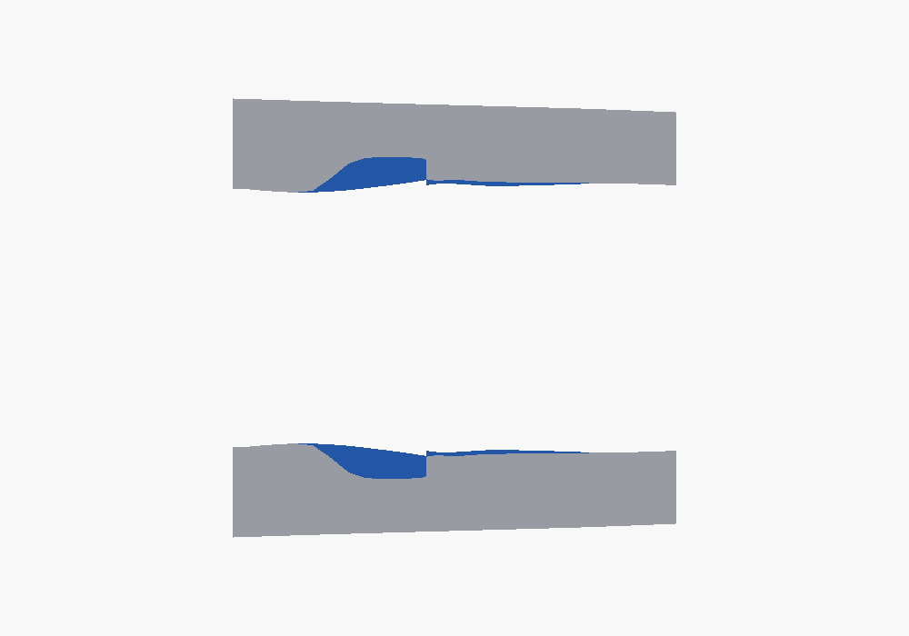

*0.15 → 0.8 (with chamber_width 18, to make it visible)*

### How far the full width runs (`chamber_full_length`)

Length of the full-width run (mm); 40 = Auto: it ends short of the tip.

Below 40 this is a length in mm, counted from where the chamber reaches its full width.
At 40 the slider switches to **Auto**: the full-width run ends a set distance before the chamber closes
(the larger of 4 mm and 12% of the overall length), so 40 is not a literal 40 mm, and it is a bit
shorter than the value just below it. The finished passage is also limited by the window and the wall.

Range: 0 to 40, step 0.5.

Presets: Alto `40` · Tenor `40` · Bari `40` · Soprano `40`.

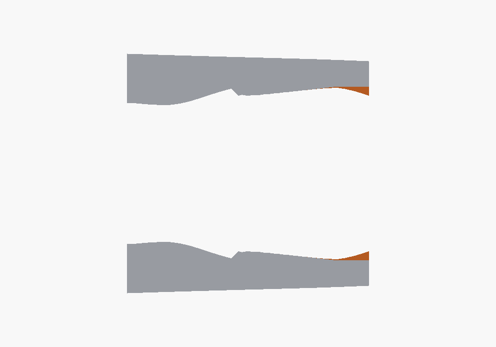

*5 → 40 (with chamber_width 18, to make it visible)*

### Chamber height (`chamber_height`)

Target chamber height before the window (mm); 0 = Auto (no extra height).

**0 is Auto**: no extra height is asked for (the chamber keeps the shape its width and shape setting give,
which is not necessarily round). Any value above 0 is a **target height** in mm, so going from 0 to 0.1
asks for a much flatter passage, not a tiny change. The change is blended in from the throat, shared
between roof and floor until the baffle takes over, and the floor takes the rest further on.
Walls and the channel clearance still limit it, and it only acts in the space before the window
(short on some presets, e.g. the tenor).

Range: 0 to 30, step 0.1.

Presets: Alto `0` · Tenor `0` · Bari `0` · Soprano `0`.

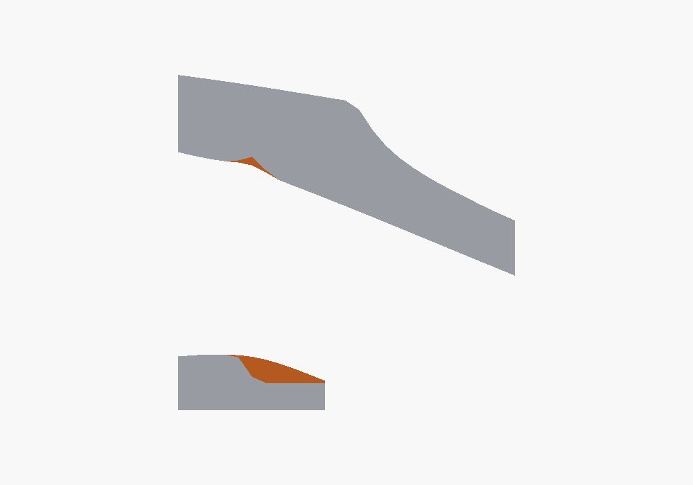

*0 → 18*

### Chamber floor (`floor_shape`)

Floor from throat to window: - drops early (deeper), + stays high (a ramp). Not with floor points.

Bends the built-in floor between the throat and the window. It has **no effect while Floor points are set**:
the supplied tenor and soprano have them, so use Shape charts → Edit shape (Floor) or clear their floor points
to use this slider.

Range: -1 to 1, step 0.05.

Presets: Alto `0` · Tenor `0` · Bari `0` · Soprano `0`.

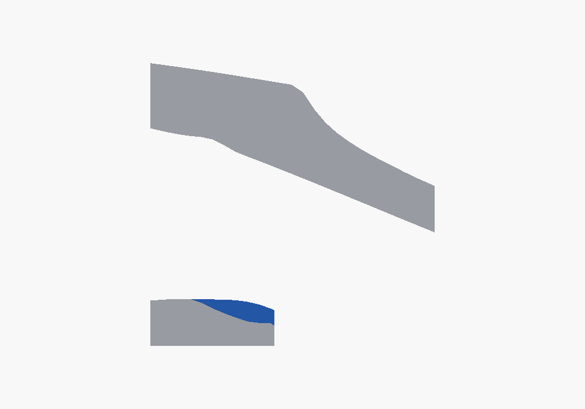

*-0.8 → 0.8*

### Throat position (`throat_position`)

Where the bore opens into the chamber (the throat), from the neck end (mm).

Range: 20 to 90, step 0.5.

Presets: Alto `43.5` · Tenor `53.0` · Bari `86.5` · Soprano `34.5`.

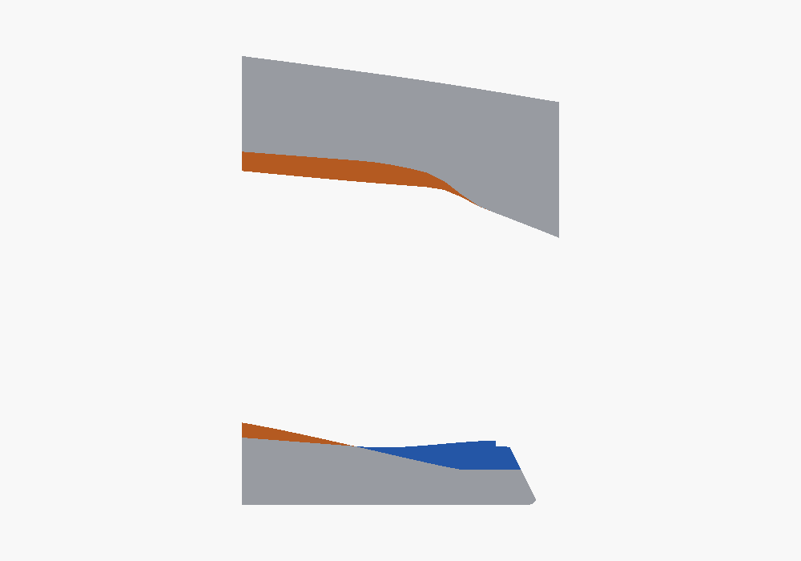

*26 → 61*

### Throat width (`throat_width`)

Width of the throat, where the bore opens into the chamber (mm).

The throat is where the bore opens into the chamber. A chamber narrower than the throat is allowed, so
it is not always the narrowest place inside.

Range: 5 to 24, step 0.1.

Presets: Alto `14.2` · Tenor `14.9` · Bari `14.8` · Soprano `9.3`.

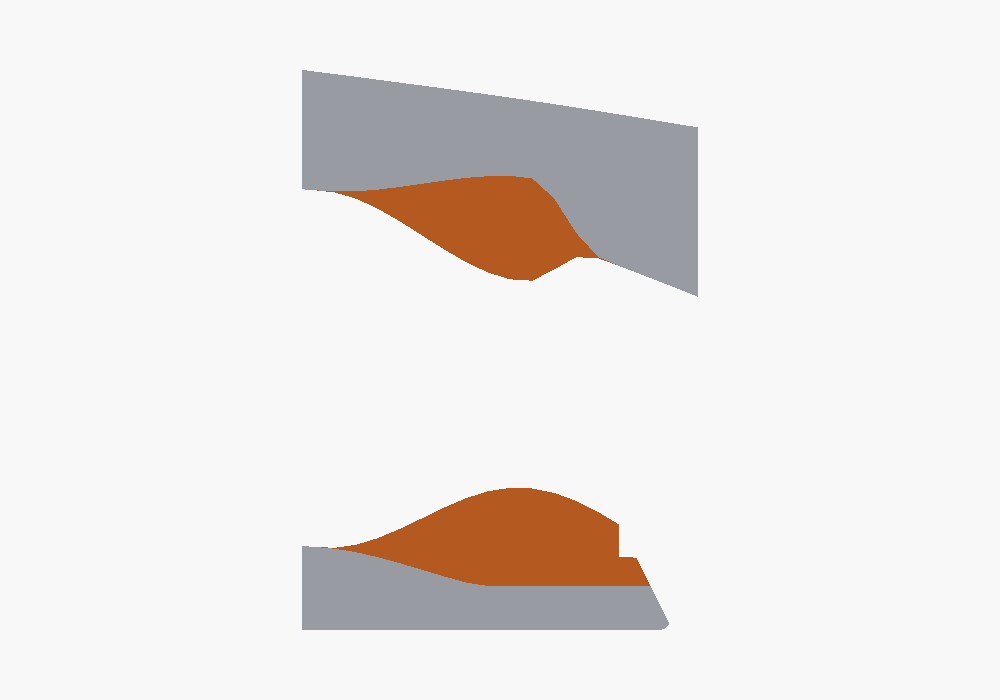

*9.4 → 18.9*

### Narrowing into the throat (`throat_taper`)

Length of the bore's narrowing into the throat (mm). Short = an abrupt step.

Range: 1 to 80, step 0.5.

Presets: Alto `9` · Tenor `11` · Bari `55` · Soprano `3`.

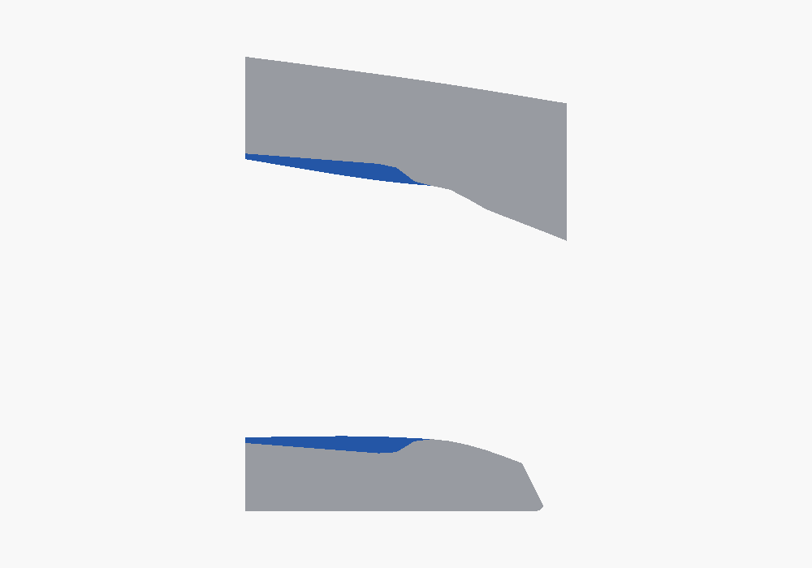

*2 → 16*

### Throat shape (`throat_shape`)

Throat cross-section; "chamber" = the same as the chamber.

Range: `chamber`, `round`, `square`, `horseshoe`.

Presets: Alto `chamber` · Tenor `chamber` · Bari `chamber` · Soprano `chamber`.

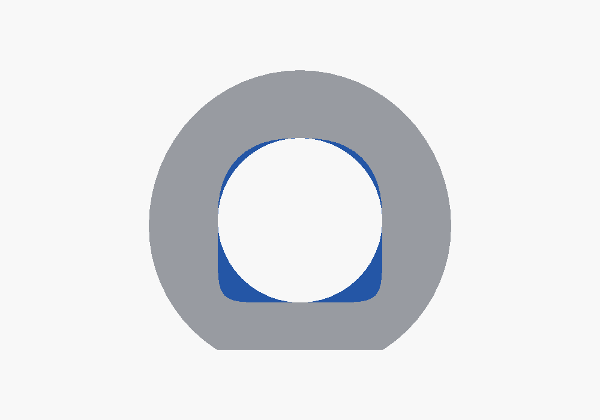

*`chamber` (the alto's) → `round`*

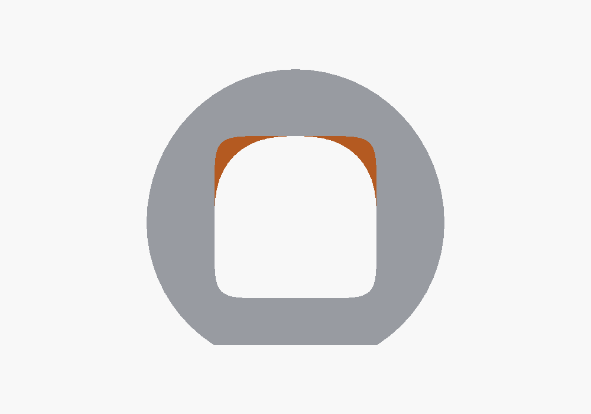

*`chamber` (the alto's) → `square`*

## Baffle

### Baffle shape (`baffle_type`)

The roof's shape over the reed (see the picture); Original = the preset's own.

Range: `measured`, `flat`, `rollover`, `step`, `concave`.

Presets: Alto `measured` · Tenor `measured` · Bari `measured` · Soprano `measured`.

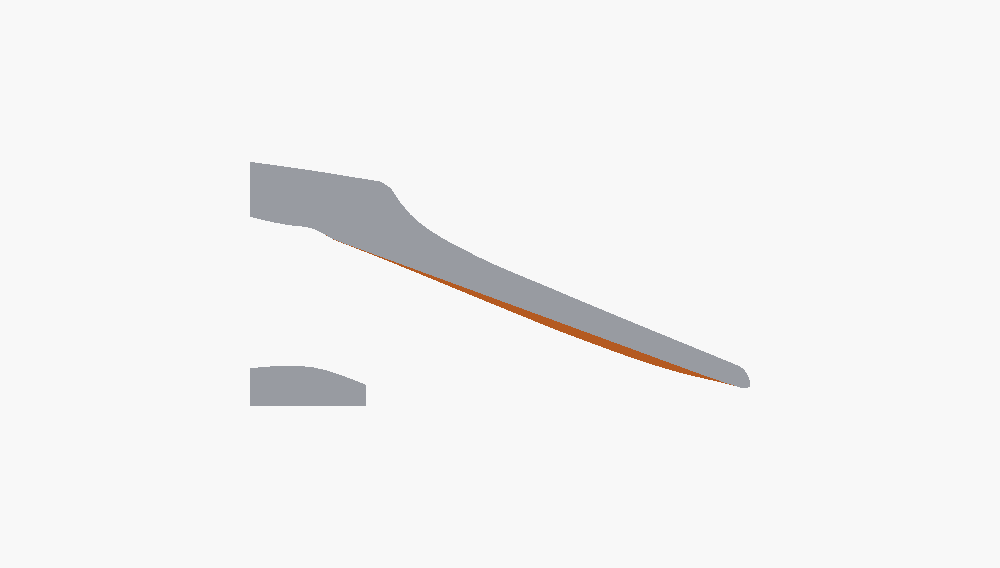

*`measured` (the alto's) → `flat`*

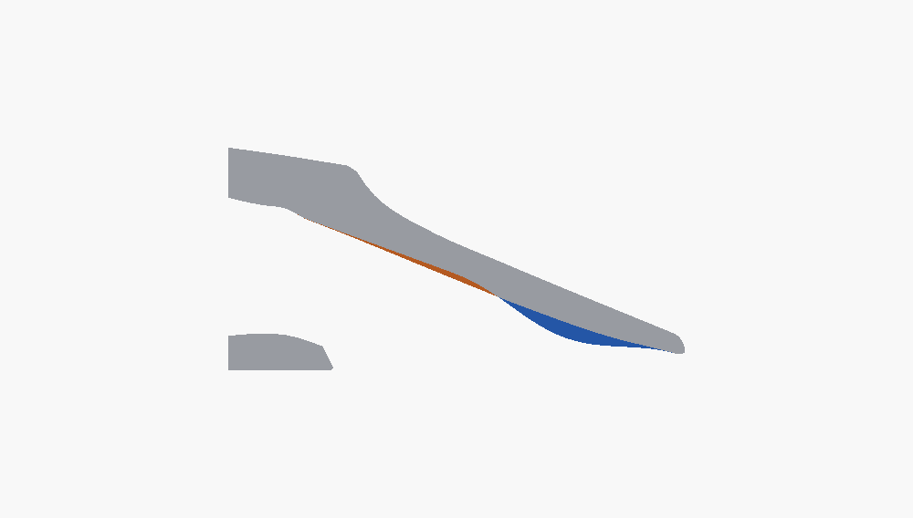

*`measured` (the alto's) → `rollover`*

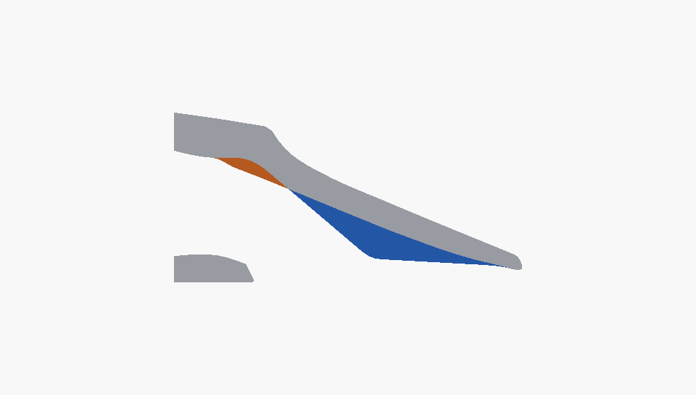

*`measured` (the alto's) → `step`*

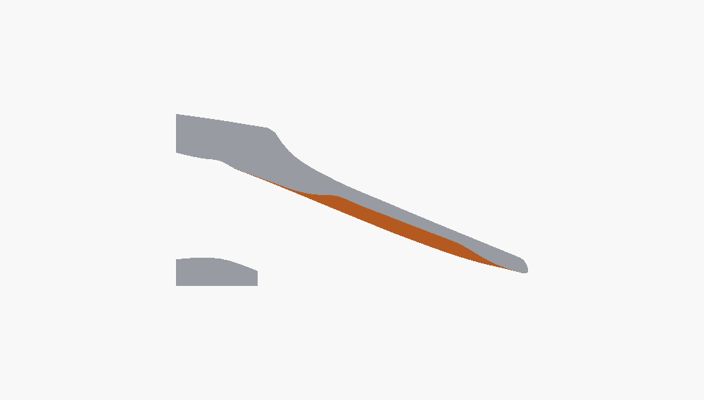

*`measured` (the alto's) → `concave`*

### Baffle height (`baffle_height`)

Baffle height change (mm): + toward the reed, - away from it; 0 = as the preset.

Range: -3 to 4, step 0.1.

Presets: Alto `0` · Tenor `0` · Bari `0` · Soprano `0`.

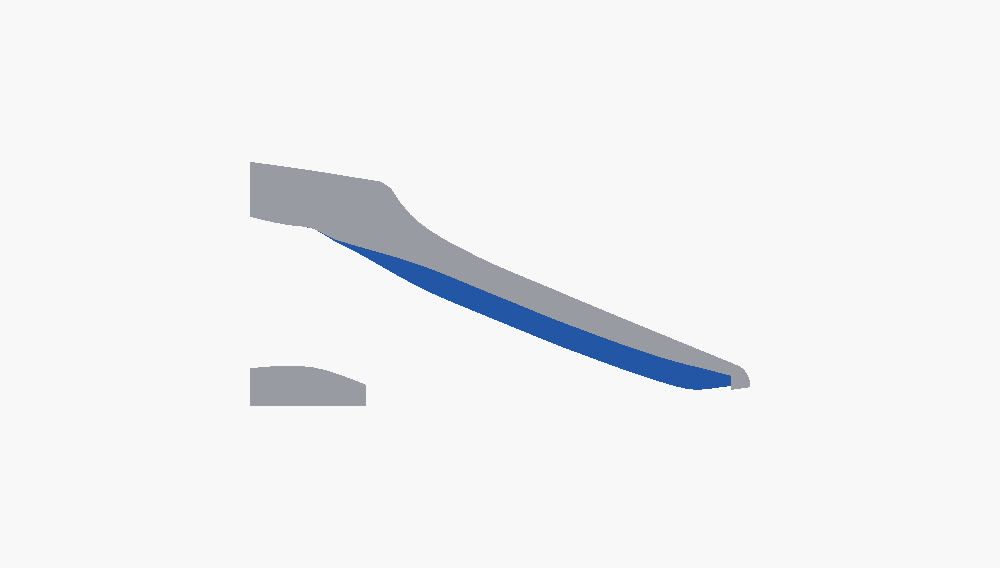

*-1 → 1.5*

### Baffle length (`baffle_length`)

Baffle length change (mm): + longer toward the shank, - shorter; the tip end stays.

Range: -40 to 15, step 0.5.

Presets: Alto `0` · Tenor `0` · Bari `0` · Soprano `0`.

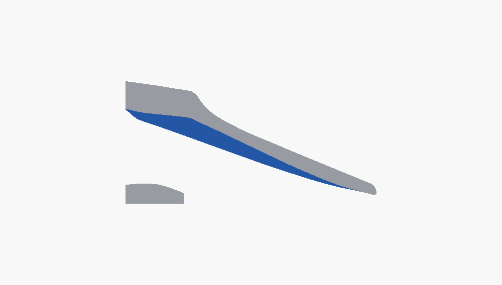

*-6 → 6*

### Baffle curve (`baffle_curve`)

Bends the baffle: - comes down early, + stays up and drops late.

Walking from the chamber toward the tip: negative comes down to the reed earlier, positive later.

Range: -1 to 1, step 0.05.

Presets: Alto `0` · Tenor `0` · Bari `0` · Soprano `0`.

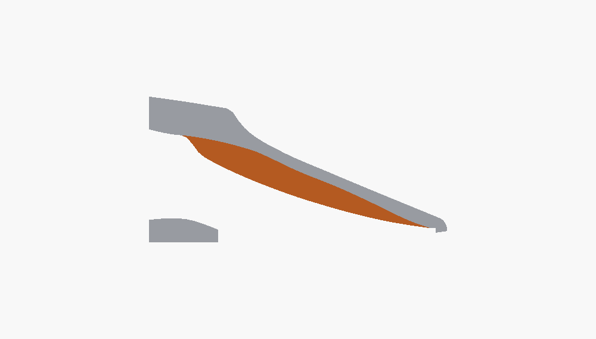

*-0.6 → 0.6*

### Step (`step_size`)

How big and abrupt the step is; 0 = a plain slope (Step baffle only).

Only the **Step** baffle uses this. Custom baffle points bypass the baffle shape (and so this slider).

Range: 0 to 1, step 0.05.

Presets: Alto `1` · Tenor `1` · Bari `1` · Soprano `1`.

### Baffle hump (`baffle_hump`)

Height of a smooth hump on the baffle just behind the tip (mm).

Range: 0 to 3, step 0.1.

Presets: Alto `0` · Tenor `0` · Bari `0` · Soprano `0`.

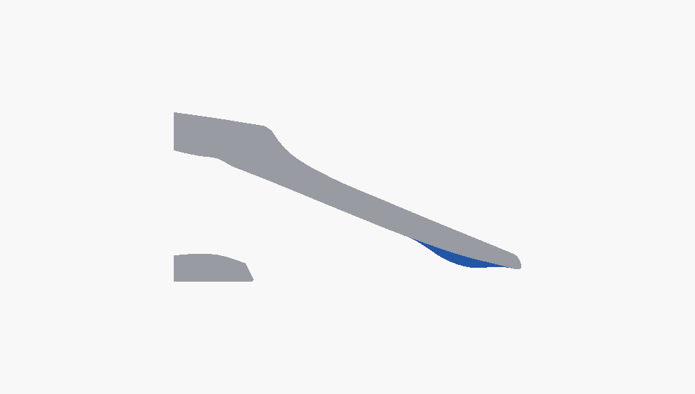

*0 → 1.5*

### Baffle texture (`baffle_texture`)

A texture on the baffle: grooves along it, grooves across it, or dimples.

Range: `none`, `along`, `across`, `dimples`.

Presets: Alto `none` · Tenor `none` · Bari `none` · Soprano `none`.

### Texture style (`baffle_texture_style`)

Texture cut into the baffle (engraved) or standing out of it (raised).

Range: `engraved`, `raised`.

Presets: Alto `engraved` · Tenor `engraved` · Bari `engraved` · Soprano `engraved`.

### Texture width (`baffle_texture_thickness`)

Width of each groove or dimple (mm); kept under the spacing, the depth giving way.

Range: 0.3 to 4, step 0.05.

Presets: Alto `2` · Tenor `2` · Bari `2` · Soprano `2`.

### Texture depth (`baffle_texture_depth`)

How deep the texture cuts, or how far it stands out (mm); less where there is no room.

Range: 0.1 to 1, step 0.05.

Presets: Alto `0.4` · Tenor `0.4` · Bari `0.4` · Soprano `0.4`.

### Texture spacing (`baffle_texture_spacing`)

Distance between the grooves or dimples (mm).

Range: 1 to 8, step 0.1.

Presets: Alto `3` · Tenor `3` · Bari `3` · Soprano `3`.

### How far across (`baffle_texture_extent`)

How far across the baffle the texture reaches, as a share of its width (1 = wall to wall).

Range: 0.2 to 1, step 0.05.

Presets: Alto `1` · Tenor `1` · Bari `1` · Soprano `1`.

### Groove shape (`baffle_texture_shape`)

How grooves across bend, when they do: a smooth curve or a V.

Range: `curved`, `v`.

Presets: Alto `curved` · Tenor `curved` · Bari `curved` · Soprano `curved`.

### Groove bend (`baffle_texture_bend`)

How much grooves across bend: - the middle trails toward the shank, + it leads toward the tip.

Range: -1 to 1, step 0.05.

Presets: Alto `0` · Tenor `0` · Bari `0` · Soprano `0`.

### Bend change toward the tip (`baffle_texture_bend_change`)

How the bend changes toward the tip end (added there, eased in along the baffle).

Range: -2 to 2, step 0.05.

Presets: Alto `0` · Tenor `0` · Bari `0` · Soprano `0`.

## Window

### Window length (`window_length`)

Length of the opening under the reed (mm).

Measured from the back of the window to the mouthpiece tip. The front rail takes part of it, so the
clear opening on the centreline is this length minus the tip rail thickness.

Range: 8 to 70, step 0.5.

Presets: Alto `39.0` · Tenor `42.0` · Bari `54.3` · Soprano `28.3`.

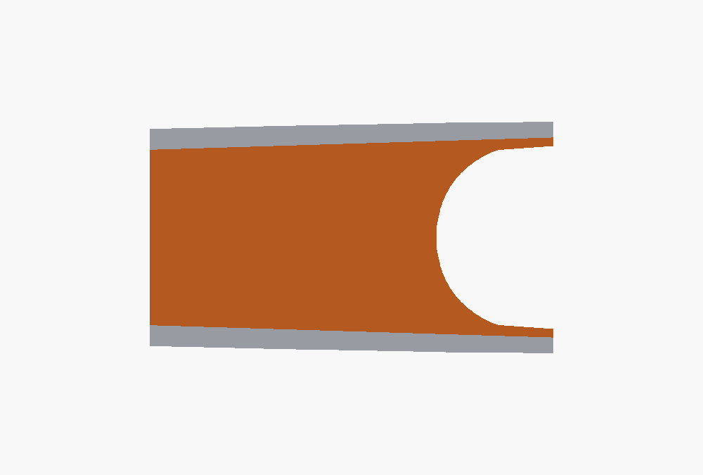

*23.5 → 54.5*

### Window corner rounding (`window_rear_radius`)

Rounding of the window's back corners (mm).

Range: 0 to 10, step 0.1.

Presets: Alto `5.5` · Tenor `5.3` · Bari `6.3` · Soprano `4.8`.

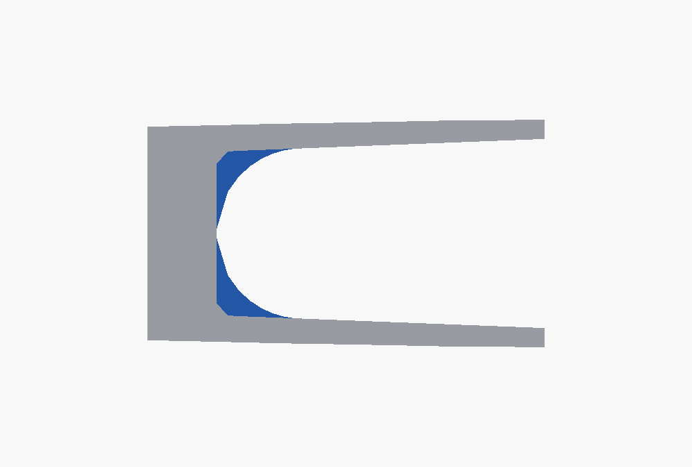

*1 → 8*

### Chamber side walls (`sidewall_angle`)

Chamber side walls (degrees): + lean out toward the roof, - lean in (a trapezoid).

Tilts the chamber's side walls along the whole chamber, starting gently at the throat.

- **0**: no extra lean (the chamber shape can still curve the walls).
- **Negative** (lean in): narrower toward the roof, a trapezoid chamber. About -10 degrees gives
  the classic trapezoid.
- **Positive** (lean out): wider toward the roof.

The walls never get thinner than the generator's minimum, so at large angles it stops leaning
further where there isn't room.

Range: -20 to 30, step 1.

Presets: Alto `0` · Tenor `0` · Bari `0` · Soprano `0`.

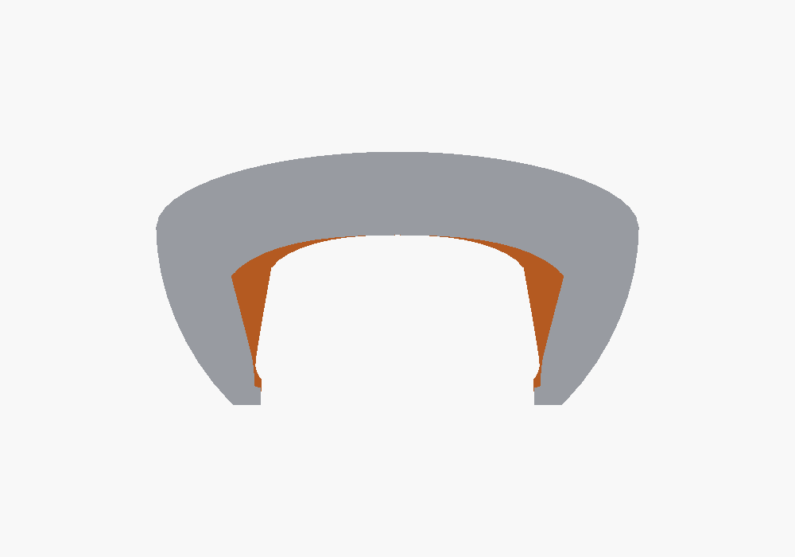

*-10 → 15*

### Side rail width (`side_rail_width`)

Width of the side rails the reed seals on (mm); the window fills the rest.

Measured just behind the tip curve, from the window's edge to the body's side; the window is what the rails leave. Toward the back it changes by Side rails widen toward the back.

Range: 0.8 to 2.5, step 0.05.

Presets: Alto `0.85` · Tenor `1.6` · Bari `2.05` · Soprano `1.95`.

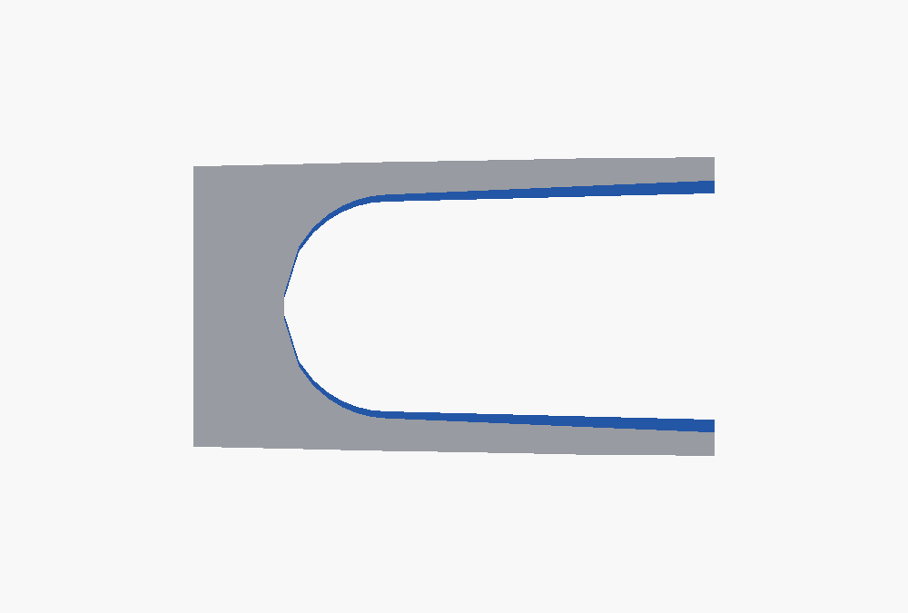

*0.8 → 1.8*

### Side rails widen toward the back (`side_rail_widening`)

How much wider the side rails get toward the back of the window (mm); 0 = even.

The rails at the back of the window are Side rail width plus this. Between the tip end and the back the window's sides run straight, as on a milled window, so the rails in between follow the body.

Range: -1 to 2, step 0.05.

Presets: Alto `0.3` · Tenor `0.45` · Bari `-0.25` · Soprano `-0.3`.

### Tip rail thickness (`tip_rail_thickness`)

Thickness of the tip rail (mm).

Front-to-back distance of the rail at the tip, seen from the reed side. It is not the beak's thickness.

Range: 0.3 to 3, step 0.02.

Presets: Alto `0.9` · Tenor `0.9` · Bari `0.9` · Soprano `0.9`.

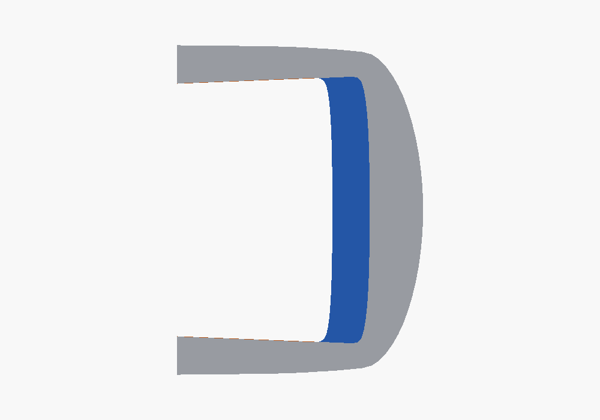

*1 → 3*

### Slope the inside of the tip (`tip_bevel`)

Slope the inside of the tip at 45 degrees so it prints without sagging.

Standing on its shank on the print bed, the inside of the tip is a small flat ceiling with nothing
under it, and it can sag. On, it fills that corner with a 45 degree slope from the window's front
edge up to the baffle, so it prints cleanly.

It only adds material inside the tip: the tip rail, the facing and the window on the reed side are
exactly as with it off. Leave it off if you print lying down or with supports.

Range: on / off.

Presets: Alto `false` · Tenor `false` · Bari `false` · Soprano `false`.

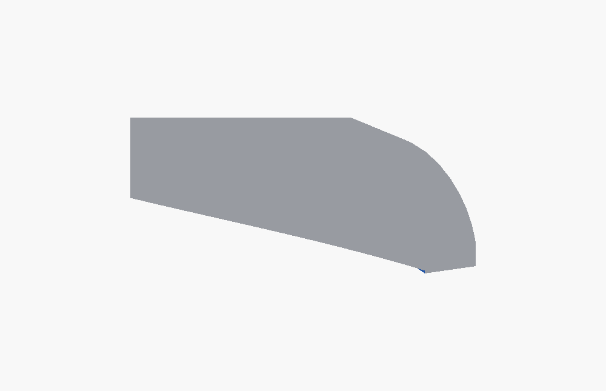

*off → on*

### Tip roundness (`tip_curve`)

How round the tip is, seen from above: how far back its curve reaches (mm).

Range: 0.5 to 12, step 0.1.

Presets: Alto `3.5` · Tenor `3.8` · Bari `4.3` · Soprano `3.5`.

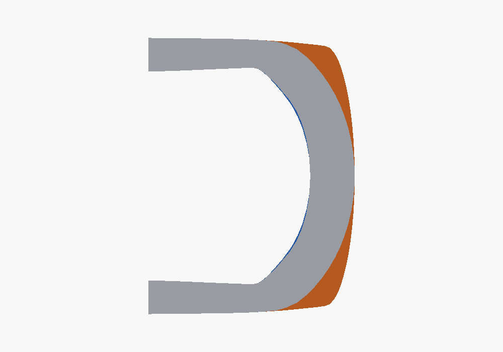

*2 → 6*

## Table

### Table width at the tip (`table_width_tip`)

Width of the reed seat at the tip (mm). Match your reed.

Range: 8 to 30, step 0.1.

Presets: Alto `16.8` · Tenor `17.6` · Bari `19.5` · Soprano `14.9`.

*11.3 → 22.3*

### Table width at the back (`table_width_rear`)

Width of the reed seat at the back (mm). Match your reed's heel.

Range: 8 to 30, step 0.1.

Presets: Alto `13.2` · Tenor `14.7` · Bari `13.9` · Soprano `11.3`.

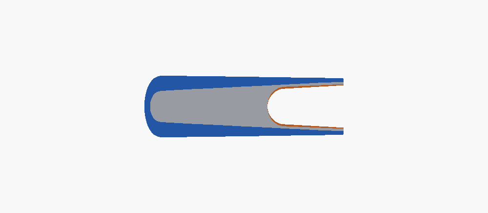

*8 → 18.7*

### Table length (`table_length`)

From the tip to the table's back end (mm), facing included; longer than the reed is normal.

Range: 50 to 120, step 0.5.

Presets: Alto `71.8` · Tenor `77.7` · Bari `101.5` · Soprano `55.44`.

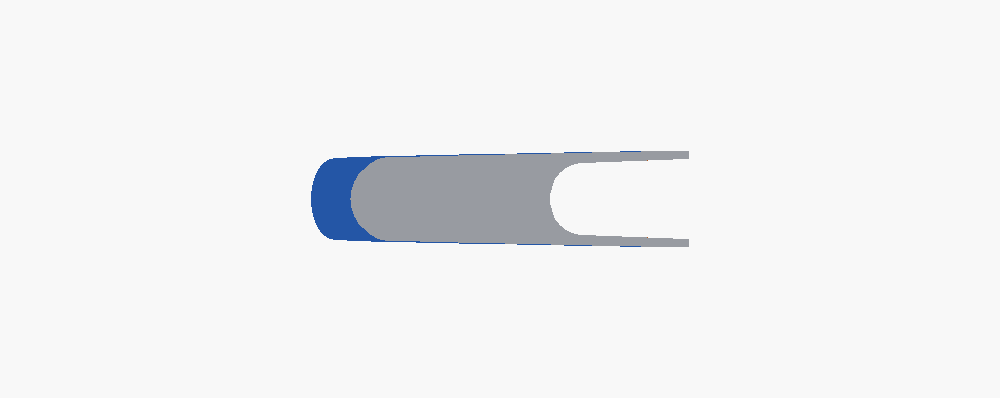

*66 → 76*

### Table hollow (`table_concavity`)

A slight hollow along the reed seat (mm) so the reed seals at both ends.

A hollow along the length of the table (not across its width), deepest halfway between the table's rear
end and the facing break.

Range: 0 to 0.3, step 0.005.

Presets: Alto `0` · Tenor `0` · Bari `0` · Soprano `0`.

## Facing

### Tip opening (`tip_opening`)

Gap at the tip, from the tip rail to a straightedge on the table (mm).

Lay a straightedge on the table so it reaches past the tip; the tip opening is the gap between it
and the inside edge of the tip rail.

Makers usually quote it in thousandths of an inch: .076" = 76 thou = 1.93 mm (1 thou = 0.0254 mm).
The app shows both. Some makers use their own numbers (5, 7*, ...), which mean different openings
from maker to maker: look up the opening in mm or thousandths.

After printing, the tip may come out slightly different: [Check it against the design](PRINTING.md#4-check-it-against-the-design).

Range: 0.5 to 4.5, step 0.01.

Presets: Alto `1.93` · Tenor `2.41` · Bari `2.79` · Soprano `1.65`.

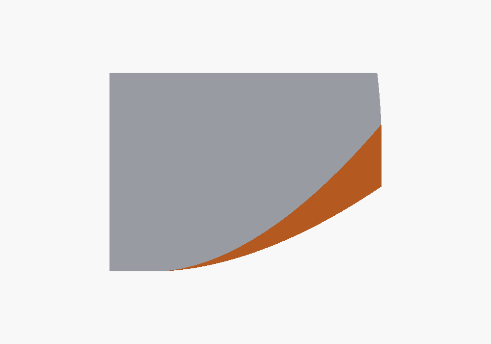

*1.5 → 2.6 (heights stretched 6x)*

### Facing length (`facing_length`)

From the tip back to the break, where the rails leave the flat table (mm).

The facing is the part of the table that curves away from the reed, from the **break** (where
the rails leave the flat table) to the tip. This is its length, measured along the table.

With the mouthpiece on a glass plate, the break is where a very thin feeler gauge slid in from the
tip stops. Longer = the curve starts further back.

Range: 10 to 45, step 0.1.

Presets: Alto `23.8` · Tenor `25.2` · Bari `28.0` · Soprano `20.0`.

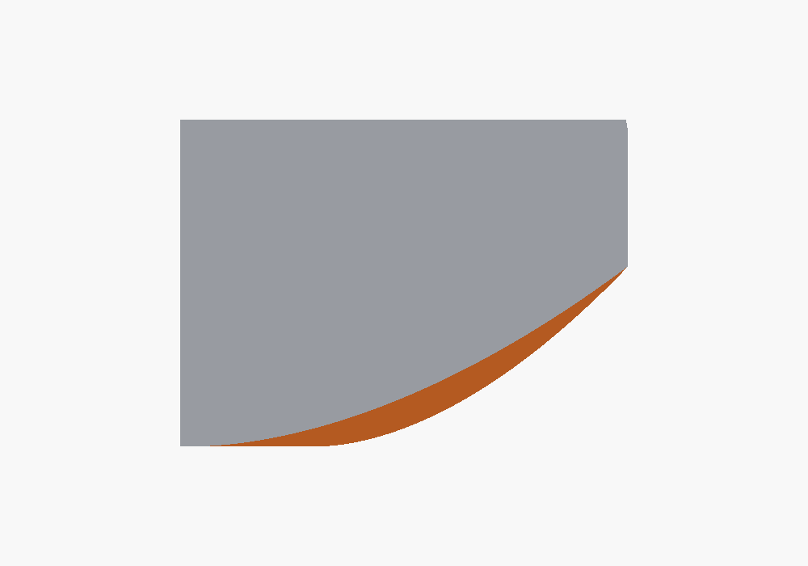

*20 → 28 (heights stretched 6x)*

### Facing curve (`facing_model`)

How the facing curves (the chart's buttons set it too): Power curve, Radius or Gauge points.

How the gap between the table line and the rails grows from the break to the tip. All three reach
exactly **Tip opening** at the tip and 0 at the break.

- **Power curve**: the gap at a point is the tip opening times (how far along the facing it is)
  to the power of **Where the curve opens**: 2 opens evenly; lower opens sooner after the break,
  higher later.
- **Radius**: a circle that touches the table at the break and passes through the tip opening, as
  traditional facing tables describe it. Its radius follows from the length and the opening.
- **Gauge points**: your own measurements (where each feeler gauge stops), joined by a smooth
  curve that never closes toward the break. Use it to copy a facing you've measured.

**Shape charts** (bottom left of the 3D view) -> **Facing curve** shows the curve and where standard feeler
gauges would stop.

Range: `power`, `arc`, `gauge`.

Presets: Alto `power` · Tenor `power` · Bari `power` · Soprano `power`.

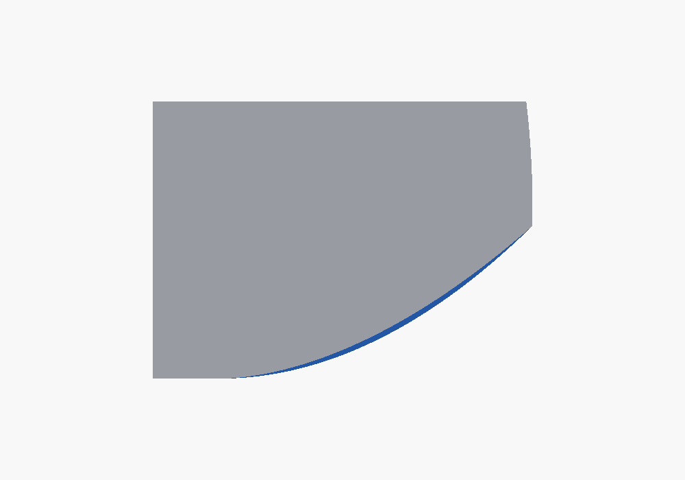

*`power` (the alto's) → `arc` (heights stretched 6x)*

### Where the curve opens (`facing_exponent`)

Power facing only: 2 opens evenly; lower opens sooner, higher later.

Used by the **Power** facing, and by Gauge when it has no usable points yet (it then falls back to Power).

Range: 1.5 to 3, step 0.05.

Presets: Alto `1.8` · Tenor `1.8` · Bari `1.8` · Soprano `1.8`.

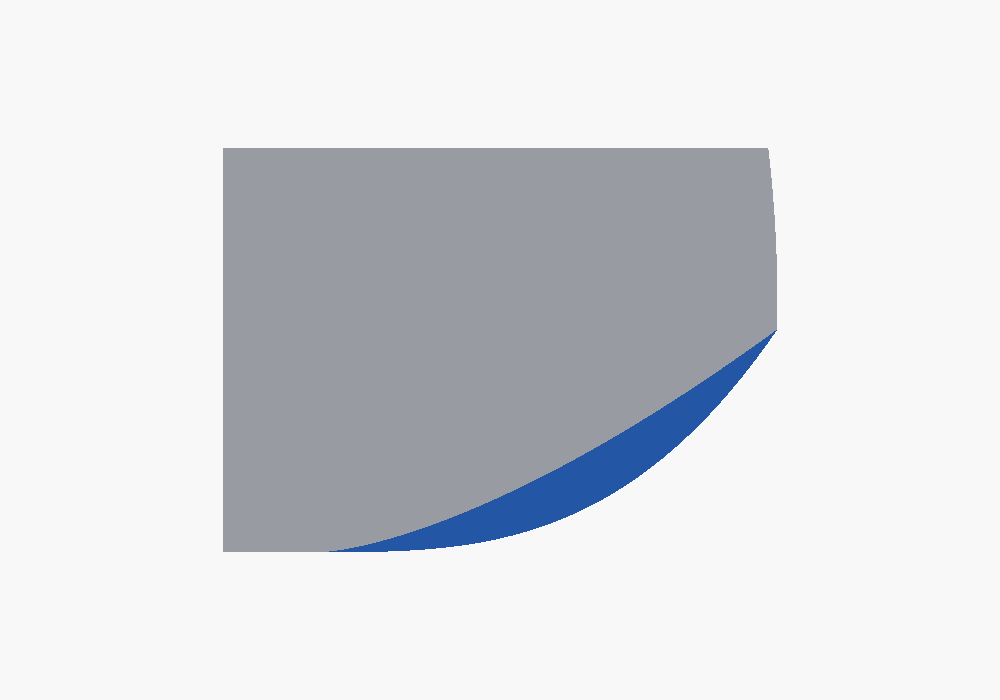

*1.5 → 3 (heights stretched 6x)*

## Exterior

### Length (`overall_length`)

Total length, neck end to tip (mm). Also changes the inside volume.

Range: 55 to 160, step 0.1.

Presets: Alto `89.3` · Tenor `96.7` · Bari `142.0` · Soprano `66.0`.

*82 → 96*

### Body width (`body_width`)

Widest outside width of the body, side to side (mm).

Range: 18 to 40, step 0.1.

Presets: Alto `29` · Tenor `30.7` · Bari `31.7` · Soprano `23.6`.

*26 → 32*

### Body height (`body_height`)

Height of the body's top above the reed table, at its tallest (mm).

Range: 18 to 40, step 0.1.

Presets: Alto `27.6` · Tenor `29.3` · Bari `30.5` · Soprano `22.5`.

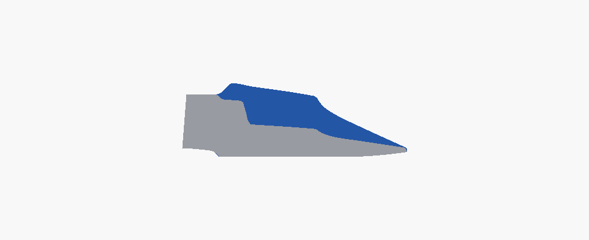

*25 → 30*

### Beak height at the tip (`beak_tip_height`)

Height of the beak above the table plane at the tip (mm).

Height above the flat table plane at the tip. The facing rises toward the tip, so this is not the
material left above the facing.

Range: 2 to 8, step 0.1.

Presets: Alto `3.6` · Tenor `3.6` · Bari `4.8` · Soprano `3.0`.

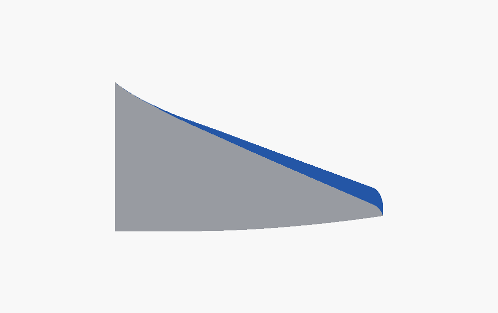

*2.8 → 5*

### Body cross-section (`body_squareness`)

Body cross-section: 2 = round, higher = boxier, lower = pointed sides.

Range: 1.2 to 8, step 0.1.

Presets: Alto `2.0` · Tenor `2.0` · Bari `2.0` · Soprano `2.0`.

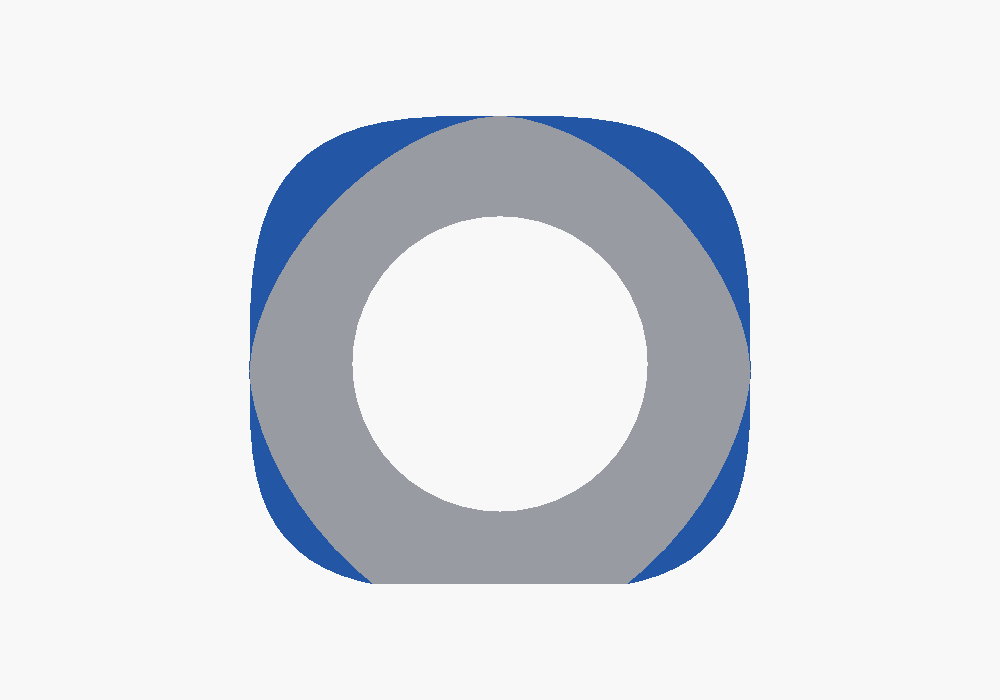

*1.5 → 4*

### Beak top (`beak_squareness`)

The beak's top, seen from the tip: ridged (a peak along it) or flat.

Low is pointed (a ridge), 2 is an ellipse, high is boxy.

Range: 1.2 to 8, step 0.1.

Presets: Alto `1.6` · Tenor `1.5` · Bari `1.4` · Soprano `1.5`.

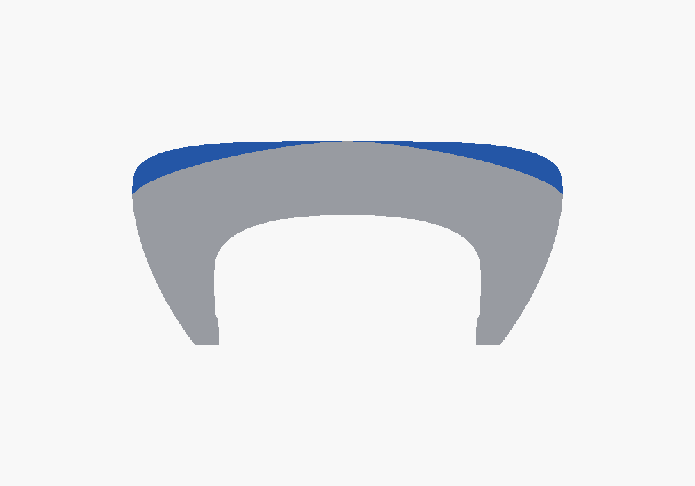

*1.2 → 4*

### Beak curve (`beak_curve`)

The beak's line from the side: full (bulging) or scooped (hollowed).

Range: -1 to 1, step 0.05.

Presets: Alto `0` · Tenor `0` · Bari `0` · Soprano `0`.

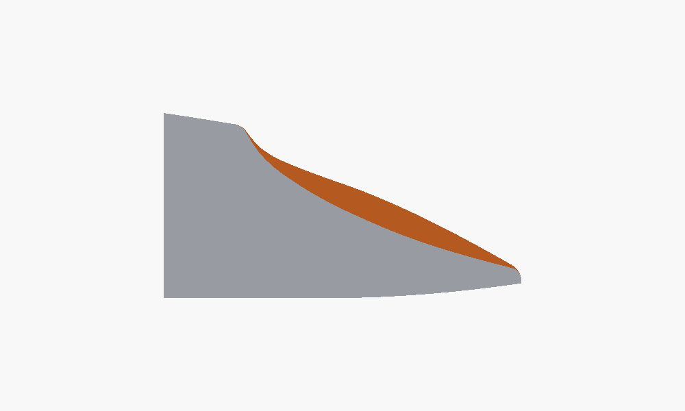

*-0.8 → 0.8*

### Beak length (`beak_length`)

Beak length change (mm): + moves the shoulder toward the shank (longer beak), - toward the tip.

Range: -15 to 15, step 0.5.

Presets: Alto `0` · Tenor `0` · Bari `0` · Soprano `0`.

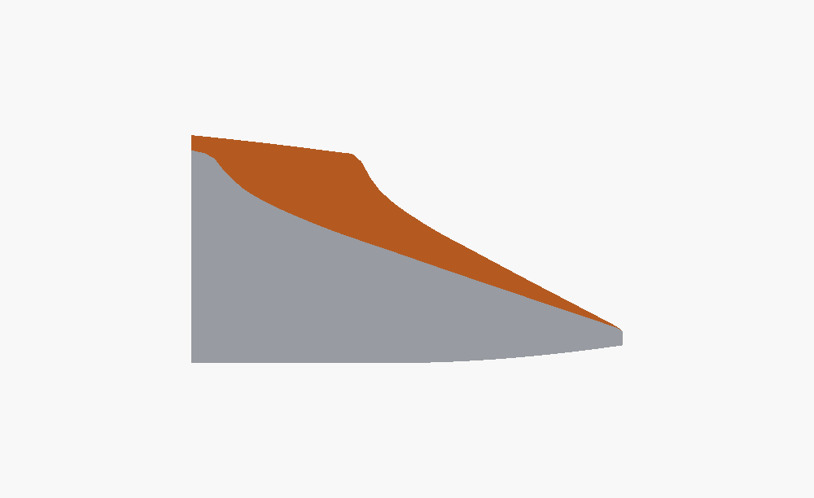

*-8 → 8*

### Shoulder smoothness (`shoulder_smoothness`)

0 = a crisp step (as designed), 1 = a smooth, gradual drop into the beak.

Range: 0 to 1, step 0.05.

Presets: Alto `0` · Tenor `0` · Bari `0` · Soprano `0`.

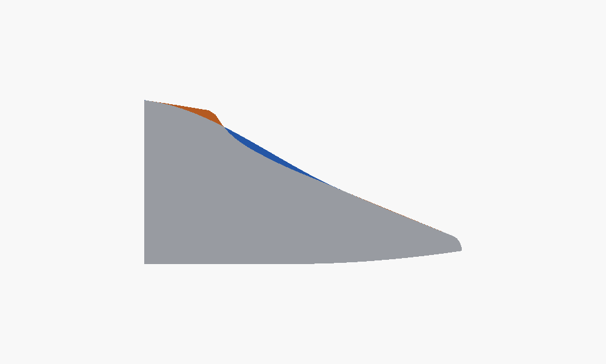

*0 → 1*

### Beak top width (`beak_top_width`)

How wide the beak's top is: - narrower, rounder top; + wider, fuller top. 0 = as designed.

Range: -1 to 1, step 0.05.

Presets: Alto `0` · Tenor `0` · Bari `0` · Soprano `0`.

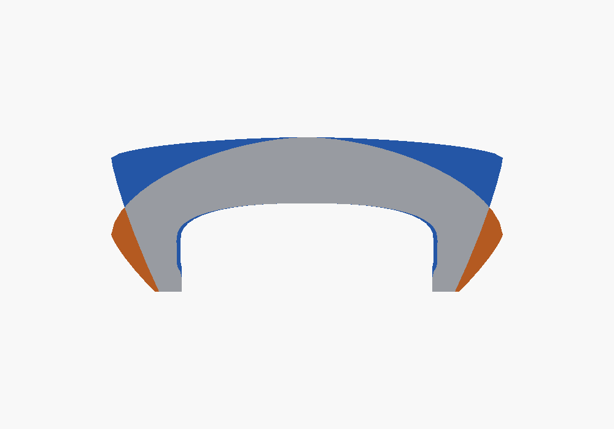

*-1 → 1*

### Shoulder sweep (`shoulder_sweep`)

How far the shoulder line runs down the sides toward the tip (mm); 0 = straight across.

Range: 0 to 20, step 0.5.

Presets: Alto `0` · Tenor `0` · Bari `0` · Soprano `0`.

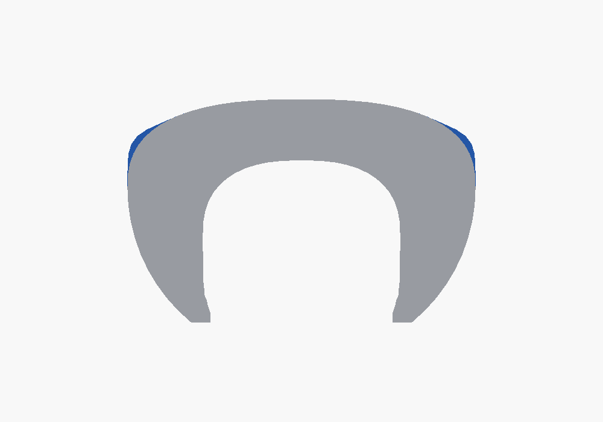

*0 → 12*

### Sides near the table (`underside_squareness`)

The lower sides near the tip, seen from the tip: tucked in (curved) or straight down.

Low is pointed, 2 is an ellipse, high is boxy.

Range: 1.2 to 8, step 0.1.

Presets: Alto `1.2` · Tenor `1.2` · Bari `1.2` · Soprano `1.2`.

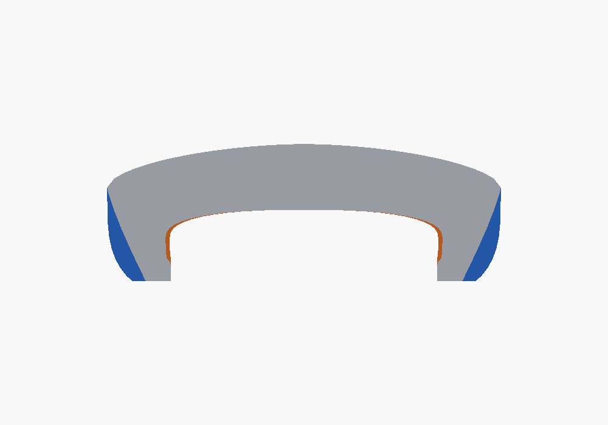

*1.2 → 4*

## Lettering

Text and pictures on the outside. The app's **Personalize** section has the main ones.

### Text on top (`top_text`)

Text on top (empty = none), several lines OK; {tip} puts in the tip size.

Range: text.

Presets: Alto `(empty)` · Tenor `(empty)` · Bari `(empty)` · Soprano `(empty)`.

### Text size (`top_text_size`)

Letter height (mm).

Range: 2 to 20, step 0.5.

Presets: Alto `5` · Tenor `5` · Bari `5` · Soprano `5`.

### Text direction (`top_text_angle`)

Which way the text reads: along the mouthpiece or across it (flipped = upside down).

Range: 0 to 270, step 90.

Presets: Alto `90` · Tenor `90` · Bari `90` · Soprano `90`.

### Text position (`top_text_position`)

Moves the top text toward the tip (+) or the shank (-) (mm).

Range: -50 to 50, step 0.5.

Presets: Alto `0` · Tenor `0` · Bari `0` · Soprano `0`.

### Picture on top (`top_image`)

A picture (SVG file) on top; solid shapes work, thin line drawings don't.

Range: text.

Presets: Alto `(empty)` · Tenor `(empty)` · Bari `(empty)` · Soprano `(empty)`.

### Picture size (`top_image_width`)

Picture width (mm).

Range: 4 to 90, step 0.5.

Presets: Alto `14` · Tenor `14` · Bari `14` · Soprano `14`.

### Picture height / width (`top_image_aspect`)

Picture height / width, for spacing (the app fills it in).

Range: 0.1 to 10, step 0.01.

Presets: Alto `1` · Tenor `1` · Bari `1` · Soprano `1`.

### Picture rotation (`top_image_angle`)

Picture rotation (degrees).

Range: 0 to 345, step 15.

Presets: Alto `0` · Tenor `0` · Bari `0` · Soprano `0`.

### Picture position (`top_image_position`)

Moves the picture toward the tip (+) or the shank (-) (mm).

Range: -50 to 50, step 0.5.

Presets: Alto `0` · Tenor `0` · Bari `0` · Soprano `0`.

### Wrap picture around to the table (`top_image_wrap`)

Wrap the picture around the body like a label.

Range: on / off.

Presets: Alto `false` · Tenor `false` · Bari `false` · Soprano `false`.

### Text, right side (`side_text_right`)

Text on the right side (seen from above, tip away). Lines, variables as on top.

Range: text.

Presets: Alto `(empty)` · Tenor `(empty)` · Bari `(empty)` · Soprano `(empty)`.

### Text, left side (`side_text_left`)

Text on the left side.

Range: text.

Presets: Alto `(empty)` · Tenor `(empty)` · Bari `(empty)` · Soprano `(empty)`.

### Side text size (`side_text_size`)

Side letter height (mm).

Range: 1.5 to 10, step 0.5.

Presets: Alto `3.5` · Tenor `3.5` · Bari `3.5` · Soprano `3.5`.

### Side text position (`side_text_position`)

Side text from just behind the ligature: + toward the tip, - toward the shank (mm).

Range: -50 to 50, step 0.5.

Presets: Alto `0` · Tenor `0` · Bari `0` · Soprano `0`.

### Side text up / down (`side_text_vertical`)

Moves the side text up (+) or down (-) (mm).

Range: -10 to 10, step 0.5.

Presets: Alto `0` · Tenor `0` · Bari `0` · Soprano `0`.

### Lettering style (`lettering_style`)

Ligature and cap lettering; the mouthpiece's is always engraved (the ligature slides over it).

Range: `engraved`, `raised`.

Presets: Alto `engraved` · Tenor `engraved` · Bari `engraved` · Soprano `engraved`.

### Lettering depth (`lettering_depth`)

How deep the letters go, or how far they stand out (mm).

Range: 0.2 to 1.5, step 0.05.

Presets: Alto `0.5` · Tenor `0.5` · Bari `0.5` · Soprano `0.5`.

### Font (`lettering_font`)

Typeface. Keep script faces 5mm or taller.

Range: `Sans Bold`, `Sans`, `Serif Bold`, `Serif`, `Serif Italic`, `Mono Bold`, `Bebas Neue`, `Marcellus SC`, `Rozha One`, `Alfa Slab One`, `Audiowide`, `Black Ops One`, `Lobster`, `Pacifico`, `Kaushan Script`.

Presets: Alto `Sans Bold` · Tenor `Sans Bold` · Bari `Sans Bold` · Soprano `Sans Bold`.

### Lettering distance from the tip (`lettering_tip_clearance`)

Keeps lettering this far back from the tip (mm).

Range: 5 to 60, step 0.5.

Presets: Alto `22` · Tenor `22` · Bari `22` · Soprano `22`.

### Top text font (`top_text_font`)

The top text's own typeface; same = the Font above.

Range: `same`, `Sans Bold`, `Sans`, `Serif Bold`, `Serif`, `Serif Italic`, `Mono Bold`, `Bebas Neue`, `Marcellus SC`, `Rozha One`, `Alfa Slab One`, `Audiowide`, `Black Ops One`, `Lobster`, `Pacifico`, `Kaushan Script`.

Presets: Alto `same` · Tenor `same` · Bari `same` · Soprano `same`.

### Side text font (`side_text_font`)

The side texts' own typeface; same = the Font above.

Range: `same`, `Sans Bold`, `Sans`, `Serif Bold`, `Serif`, `Serif Italic`, `Mono Bold`, `Bebas Neue`, `Marcellus SC`, `Rozha One`, `Alfa Slab One`, `Audiowide`, `Black Ops One`, `Lobster`, `Pacifico`, `Kaushan Script`.

Presets: Alto `same` · Tenor `same` · Bari `same` · Soprano `same`.

### Text around the shank (`shank_text`)

Text around the shank's round band at the neck end (empty = none); variables as on top.

Range: text.

Presets: Alto `(empty)` · Tenor `(empty)` · Bari `(empty)` · Soprano `(empty)`.

### Shank text size (`shank_text_size`)

Shank letter height (mm); the band is short, so keep it small.

Range: 1.5 to 8, step 0.5.

Presets: Alto `3` · Tenor `3` · Bari `3` · Soprano `3`.

### Shank text around (`shank_text_around`)

Where around the shank the text is centred (degrees): 0 = top, 90 = right, -90 = left.

Range: -180 to 180, step 15.

Presets: Alto `0` · Tenor `0` · Bari `0` · Soprano `0`.

### Shank text font (`shank_text_font`)

The shank text's own typeface; same = the Font above.

Range: `same`, `Sans Bold`, `Sans`, `Serif Bold`, `Serif`, `Serif Italic`, `Mono Bold`, `Bebas Neue`, `Marcellus SC`, `Rozha One`, `Alfa Slab One`, `Audiowide`, `Black Ops One`, `Lobster`, `Pacifico`, `Kaushan Script`.

Presets: Alto `same` · Tenor `same` · Bari `same` · Soprano `same`.

### Shank decoration (`shank_detail`)

Decoration on the shank's band: rounded rings, V flutes along it, a spiral or knurling.

Range: `none`, `rings`, `flutes`, `spiral`, `knurled`.

Presets: Alto `none` · Tenor `none` · Bari `none` · Soprano `none`.

### Cut in or raised (`shank_detail_style`)

Shank decoration cut in (engraved) or standing out (raised).

Range: `engraved`, `raised`.

Presets: Alto `engraved` · Tenor `engraved` · Bari `engraved` · Soprano `engraved`.

### How many (`shank_detail_count`)

How many rings (as many as fit), flutes, spiral starts (up to 4) or knurl lines each way.

Range: 1 to 40, step 1.

Presets: Alto `3` · Tenor `3` · Bari `3` · Soprano `3`.

### Ring position (`shank_detail_position`)

Where a single ring sits: 0 = by the neck end, 1 = by the flare.

Range: 0 to 1, step 0.05.

Presets: Alto `0.25` · Tenor `0.25` · Bari `0.25` · Soprano `0.25`.

### Shank decoration depth (`shank_detail_depth`)

How deep the rings or flutes go, or how far they stand out (mm); 1.2mm of wall stays.

Range: 0.3 to 1.2, step 0.05.

Presets: Alto `0.6` · Tenor `0.6` · Bari `0.6` · Soprano `0.6`.

### How far up the shank (`shank_detail_length`)

How far up the shank decoration and text reach (mm); 0 = to the flare.

Range: 0 to 30, step 1.

Presets: Alto `0` · Tenor `0` · Bari `0` · Soprano `0`.

## Profile overrides

Point lists (OpenSCAD's Customizer can't edit them; the app does, under **Points → Exact points** and in **Shape charts**). Three kinds, all with the points in increasing order, joined by a smooth curve that does not overshoot the points; the wall and clearance limits still apply:

- **Replacement profiles** (`ext_*`, `table_width_points`, `interior_*`, `floor_points`, `baffle_points_custom`): `[[mm from the shank end, value], ...]`; the value is an absolute height or width, or a squareness. They replace the built-in curve; `[]` keeps it. Example: `floor_points = [[40, 3.4], [46, 3.2], [52, 2.9]]` is a floor at 3.4 mm at 40 mm, falling to 2.9 mm at 52 mm.
- **Gauge facing** (`facing_gauge_points`): `[[mm back from the tip, gap in mm], ...]`, used only with the Gauge facing. Example: `[[0, 0], [10, 0.18], [20, 0.52]]` is a gap of 0.18 mm at 10 mm from the tip.
- **Shape edits** (`*_adjust`, from **Shape charts → Edit shape**): `[[fraction of the length 0-1, change in mm], ...]`, added to the shape the sliders give (so the sliders keep working), 0 at both ends unless given. They follow the overall length; a replacement profile for the same shape takes precedence. Example: `baffle_adjust = [[0.8, 0.3]]` raises the roof 0.3 mm at 80% of the length. Signs: + `baffle_adjust` moves the roof away from the reed (`baffle_height` + moves it toward the reed); width edits change the full width, not each side.

### Bore axis height (`bore_axis_height`)

Only with your own top outline: bore height at the neck end (mm).

Range: 4 to 30, step 0.1.

Presets: Alto `14.5` · Tenor `14.5` · Bari `14.5` · Soprano `14.5`.

### Ext width points (`ext_width_points`)

Advanced: outside width along the length, [[distance, width], ...]; [] = built-in.

Range: text.

Presets: Alto `[]` · Tenor `[]` · Bari `[]` · Soprano `[]`.

### Ext top points (`ext_top_points`)

Advanced: top outline along the length, [[distance, height], ...].

Range: text.

Presets: Alto `[]` · Tenor `[]` · Bari `[]` · Soprano `[]`.

### Ext bottom points (`ext_bottom_points`)

Advanced: underside behind the table, [[distance, height], ...].

Range: text.

Presets: Alto `[]` · Tenor `[]` · Bari `[]` · Soprano `[]`.

### Ext widest points (`ext_widest_points`)

Advanced: height of each section's widest point, [[distance, height], ...].

Range: text.

Presets: Alto `[]` · Tenor `[]` · Bari `[]` · Soprano `[]`.

### Ext top squareness points (`ext_top_squareness_points`)

Advanced: squareness of the upper outside, [[distance, squareness], ...].

Range: text.

Presets: Alto `[]` · Tenor `[]` · Bari `[]` · Soprano `[]`.

### Ext bottom squareness points (`ext_bottom_squareness_points`)

Advanced: squareness of the lower outside, [[distance, squareness], ...].

Range: text.

Presets: Alto `[]` · Tenor `[]` · Bari `[]` · Soprano `[]`.

### Table width points (`table_width_points`)

Advanced: reed seat width along the length, [[distance, width], ...].

Range: text.

Presets: Alto `[]` · Tenor `[]` · Bari `[]` · Soprano `[]`.

### Interior width points (`interior_width_points`)

Advanced: inside width along the length, [[distance, width], ...].

Range: text.

Presets: Alto `[]` · Tenor `[]` · Bari `[]` · Soprano `[]`.

### Interior top squareness points (`interior_top_squareness_points`)

Advanced: squareness of the upper inside, [[distance, squareness], ...].

Range: text.

Presets: Alto `[]` · Tenor `[]` · Bari `[]` · Soprano `[]`.

### Interior bottom squareness points (`interior_bottom_squareness_points`)

Advanced: squareness of the lower inside, [[distance, squareness], ...].

Range: text.

Presets: Alto `[]` · Tenor `[]` · Bari `[]` · Soprano `[]`.

### Floor points (`floor_points`)

Advanced: floor to the window (can start before the throat), [[distance, height], ...].

Range: text.

Presets: Alto `[]` · Tenor `[[40, 3.4], [46, 3.2], [52, 2.9], [54, 1.8]]` · Bari `[]` · Soprano `[[29, 2.3], [31, 2.2], [33, 2.9], [35, 2.7], [37, 2.0]]`.

### Baffle points custom (`baffle_points_custom`)

Advanced: your own baffle, [[distance, height above the table], ...]; wins over the shape.

Range: text.

Presets: Alto `[]` · Tenor `[]` · Bari `[]` · Soprano `[]`.

### Facing gauge points (`facing_gauge_points`)

Advanced: your own facing (Gauge), [[mm from the tip, gap], ...].

Range: text.

Presets: Alto `[]` · Tenor `[]` · Bari `[]` · Soprano `[]`.

### Top adjust (`top_adjust`)

Shape edits (the app's "Edit shape"): mm added to the outline after the sliders, so the sliders keep working, [[fraction of the length, mm], ...]; 0 at both ends unless given there. Shape edit: mm added to the top outline at that fraction of the length (+ = higher).

Range: text.

Presets: Alto `[]` · Tenor `[]` · Bari `[]` · Soprano `[]`.

### Underside adjust (`underside_adjust`)

Shape edit: mm added to the underside height (+ = underside moves up).

Range: text.

Presets: Alto `[]` · Tenor `[]` · Bari `[]` · Soprano `[]`.

### Width adjust (`width_adjust`)

Shape edit: mm added to the full outside width (not per side).

Range: text.

Presets: Alto `[]` · Tenor `[]` · Bari `[]` · Soprano `[]`.

### Baffle adjust (`baffle_adjust`)

Shape edit: mm added to the baffle's height above the table (+ = roof away from the reed).

Range: text.

Presets: Alto `[]` · Tenor `[]` · Bari `[]` · Soprano `[]`.

### Floor adjust (`floor_adjust`)

Shape edit: mm added to the floor height (+ = floor higher).

Range: text.

Presets: Alto `[]` · Tenor `[]` · Bari `[]` · Soprano `[]`.

### Chamber width adjust (`chamber_width_adjust`)

Shape edit: mm added to the chamber's full width (not per side).

Range: text.

Presets: Alto `[]` · Tenor `[]` · Bari `[]` · Soprano `[]`.

## Manufacturing

### Thinnest wall (`min_wall`)

Thinnest wall allowed (mm). The inside shrinks to keep it.

Range: 1.2 to 4, step 0.1.

Presets: Alto `2.0` · Tenor `2.0` · Bari `2.0` · Soprano `2.0`.

### Extra to sand off (`print_stock`)

Extra on the table and facing to sand flat after printing (mm); try 0.1-0.2.

Range: 0 to 0.5, step 0.01.

Presets: Alto `0` · Tenor `0` · Bari `0` · Soprano `0`.

*0 → 0.3 (heights stretched 6x)*

## Ligature

A ligature made to fit this mouthpiece (the app's **Ligature** section). See [the printing guide](PRINTING.md).

### Ligature made (`ligature_made`)

A ligature is made for this design (the app shows it and offers its download).

Range: on / off.

Presets: Alto `false` · Tenor `false` · Bari `false` · Soprano `false`.

### Band length (`ligature_length`)

Length of the ligature band along the mouthpiece (mm), on its short side.

Range: 6 to 30, step 0.5.

Presets: Alto `12` · Tenor `12` · Bari `12` · Soprano `10`.

### Position (`ligature_position`)

Band's front edge (mm): 0 = just behind the window, minus = over the window.

Range: -10 to 40, step 0.5.

Presets: Alto `2` · Tenor `2` · Bari `2` · Soprano `2`.

### Thickness (`ligature_wall`)

Band thickness (mm): thinner flexes onto it more easily, thicker grips harder.

Range: 1.2 to 5, step 0.1.

Presets: Alto `2.0` · Tenor `2.0` · Bari `2.0` · Soprano `2.0`.

### Shape (`ligature_shape`)

D hugs the reed flat underneath; Round is a plain ring; Follows takes the body's shape.

Range: `d`, `round`, `conform`.

Presets: Alto `d` · Tenor `d` · Bari `d` · Soprano `d`.

### Tail toward the shank (`ligature_tongue`)

A tail on one side, running toward the shank (mm); 0 = a straight band.

Range: 0 to 15, step 0.5.

Presets: Alto `7` · Tenor `7` · Bari `7` · Soprano `5`.

### Tail side (`ligature_tongue_side`)

Which side the tail runs along: the top, or under the reed.

Range: `top`, `reed`.

Presets: Alto `top` · Tenor `top` · Bari `top` · Soprano `top`.

### Gap to the body (`ligature_fit`)

Gap between the band and the mouthpiece's body (mm); the reed is squeezed instead.

Range: -0.4 to 0.5, step 0.05.

Presets: Alto `0.1` · Tenor `0.1` · Bari `0.1` · Soprano `0.1`.

### Reed grip (`ligature_reed_grip`)

How hard the band presses the reed onto the table (mm): bigger = tighter.

Range: 0 to 0.6, step 0.05.

Presets: Alto `0.2` · Tenor `0.2` · Bari `0.2` · Soprano `0.2`.

### Text on the ligature (`ligature_text`)

Text on the ligature's top (empty = none). Lines, variables as on the top text.

Range: text.

Presets: Alto `(empty)` · Tenor `(empty)` · Bari `(empty)` · Soprano `(empty)`.

### Ligature text font (`ligature_text_font`)

The ligature text's own typeface; same = the Font in Personalize.

Range: `same`, `Sans Bold`, `Sans`, `Serif Bold`, `Serif`, `Serif Italic`, `Mono Bold`, `Bebas Neue`, `Marcellus SC`, `Rozha One`, `Alfa Slab One`, `Audiowide`, `Black Ops One`, `Lobster`, `Pacifico`, `Kaushan Script`.

Presets: Alto `same` · Tenor `same` · Bari `same` · Soprano `same`.

### Text size (`ligature_text_size`)

Ligature letter height (mm).

Range: 2 to 12, step 0.5.

Presets: Alto `4` · Tenor `4` · Bari `4` · Soprano `4`.

### Text direction (`ligature_text_angle`)

Which way the ligature's text reads: along or across (flipped = upside down).

Range: 0 to 270, step 90.

Presets: Alto `90` · Tenor `90` · Bari `90` · Soprano `90`.

### Picture on the ligature (`ligature_image`)

A picture (SVG file) on the ligature; same = the mouthpiece's top picture; empty = none.

Range: text.

Presets: Alto `same` · Tenor `same` · Bari `same` · Soprano `same`.

### Picture size (`ligature_image_width`)

Ligature picture width (mm).

Range: 3 to 30, step 0.5.

Presets: Alto `8` · Tenor `8` · Bari `8` · Soprano `8`.

### Picture height / width (`ligature_image_aspect`)

Picture height / width, for spacing (the app fills it in).

Range: 0.1 to 10, step 0.01.

Presets: Alto `1` · Tenor `1` · Bari `1` · Soprano `1`.

### Picture rotation (`ligature_image_angle`)

Ligature picture rotation (degrees).

Range: 0 to 345, step 15.

Presets: Alto `0` · Tenor `0` · Bari `0` · Soprano `0`.

### Text and picture position (`ligature_lettering_position`)

Moves the ligature's text and picture toward the tip (+) or the shank (-) (mm).

Range: -15 to 15, step 0.5.

Presets: Alto `0` · Tenor `0` · Bari `0` · Soprano `0`.

## Cap

### Cap made (`cap_made`)

A cap is made for this design (the app shows it and offers its download).

Range: on / off.

Presets: Alto `false` · Tenor `false` · Bari `false` · Soprano `false`.

### Goes over (`cap_ligature`)

What the cap goes over: the ligature made for this design, or a metal one.

Range: `printed`, `metal`.

Presets: Alto `printed` · Tenor `printed` · Bari `printed` · Soprano `printed`.

### Grip squeeze (`cap_grip`)

How hard the rim squeezes the ligature (mm): bigger = tighter; 0 = no squeeze.

Range: 0 to 0.5, step 0.05.

Presets: Alto `0.15` · Tenor `0.15` · Bari `0.15` · Soprano `0.15`.

### Slot side (`cap_slot_side`)

Side of the slot up from the rim, and of a metal ligature's screws: under the reed or on top.

Range: `reed`, `top`.

Presets: Alto `reed` · Tenor `reed` · Bari `reed` · Soprano `reed`.

### Slot length (`cap_slot_length`)

Slot up from the rim, for air and so the rim clips on: length (mm); 0 = none.

Range: 0 to 80, step 1.

Presets: Alto `30` · Tenor `30` · Bari `30` · Soprano `30`.

### Slot width (`cap_slot_width`)

Slot width (mm).

Range: 1 to 8, step 0.5.

Presets: Alto `3` · Tenor `3` · Bari `3` · Soprano `3`.

### Air holes in the end (`cap_end_vents`)

Air holes through the closed end, in a row (0 = none).

Range: 0 to 7, step 1.

Presets: Alto `3` · Tenor `3` · Bari `3` · Soprano `3`.

### End hole size (`cap_end_vent_size`)

End hole diameter (mm).

Range: 1 to 4, step 0.5.

Presets: Alto `2` · Tenor `2` · Bari `2` · Soprano `2`.

### Side vents (`cap_side_vents`)

Air vents on both sides, between the rim and the tip: slots along the cap, round holes, or none.

Range: `none`, `slots`, `holes`.

Presets: Alto `none` · Tenor `none` · Bari `none` · Soprano `none`.

### Vents on each side (`cap_side_vent_count`)

How many vents on each side (slots stack up the side, holes run along it).

Range: 1 to 5, step 1.

Presets: Alto `2` · Tenor `2` · Bari `2` · Soprano `2`.

### Vent size (`cap_side_vent_size`)

Vent width, or a hole's diameter (mm).

Range: 1.5 to 5, step 0.5.

Presets: Alto `2.5` · Tenor `2.5` · Bari `2.5` · Soprano `2.5`.

### Space between vents (`cap_side_vent_gap`)

Space between neighbouring vents (mm).

Range: 1 to 10, step 0.5.

Presets: Alto `3` · Tenor `3` · Bari `3` · Soprano `3`.

### Wall thickness (`cap_wall`)

Wall thickness (mm).

Range: 1.2 to 4, step 0.1.

Presets: Alto `1.6` · Tenor `1.6` · Bari `1.6` · Soprano `1.6`.

### Shape (`cap_shape`)

Follows the mouthpiece (smoothed), or round.

Range: `conform`, `round`.

Presets: Alto `conform` · Tenor `conform` · Bari `conform` · Soprano `conform`.

### Extra length (toward the shank) (`cap_extend`)

Lengthens the cap toward the shank (mm); the most covers the whole mouthpiece.

Range: 0 to 120, step 1.

Presets: Alto `0` · Tenor `0` · Bari `0` · Soprano `0`.

### Space at the end (`cap_end_gap`)

Space between the tip and the inside of the closed end (mm).

Range: 1 to 20, step 0.5.

Presets: Alto `4` · Tenor `4` · Bari `4` · Soprano `4`.

### End shape (`cap_end_dome`)

Closed end's shape: 0.6 = a low dome, 1 = a full dome as tall as the end gap (lower needs supports).

Range: 0.6 to 1, step 0.1.

Presets: Alto `1` · Tenor `1` · Bari `1` · Soprano `1`.

### Rim bead (`cap_rim_bead`)

A raised bead around the open end (mm out from the wall); 0 = none.

Range: 0 to 1.5, step 0.1.

Presets: Alto `0.6` · Tenor `0.6` · Bari `0.6` · Soprano `0.6`.

### Text on the cap (`cap_text`)

Text on the cap's top (empty = none). Lines, variables as on the top text.

Range: text.

Presets: Alto `(empty)` · Tenor `(empty)` · Bari `(empty)` · Soprano `(empty)`.

### Cap text font (`cap_text_font`)

The cap text's own typeface; same = the Font in Personalize.

Range: `same`, `Sans Bold`, `Sans`, `Serif Bold`, `Serif`, `Serif Italic`, `Mono Bold`, `Bebas Neue`, `Marcellus SC`, `Rozha One`, `Alfa Slab One`, `Audiowide`, `Black Ops One`, `Lobster`, `Pacifico`, `Kaushan Script`.

Presets: Alto `same` · Tenor `same` · Bari `same` · Soprano `same`.

### Text size (`cap_text_size`)

Cap letter height (mm).

Range: 2 to 14, step 0.5.

Presets: Alto `5` · Tenor `5` · Bari `5` · Soprano `5`.

### Text direction (`cap_text_angle`)

Which way the cap's text reads: along or across (flipped = upside down).

Range: 0 to 270, step 90.

Presets: Alto `0` · Tenor `0` · Bari `0` · Soprano `0`.

### Picture on the cap (`cap_image`)

A picture (SVG file) on the cap; same = the mouthpiece's top picture; empty = none.

Range: text.

Presets: Alto `same` · Tenor `same` · Bari `same` · Soprano `same`.

### Picture size (`cap_image_width`)

Cap picture width (mm).

Range: 3 to 40, step 0.5.

Presets: Alto `10` · Tenor `10` · Bari `10` · Soprano `10`.

### Picture height / width (`cap_image_aspect`)

Picture height / width, for spacing (the app fills it in).

Range: 0.1 to 10, step 0.01.

Presets: Alto `1` · Tenor `1` · Bari `1` · Soprano `1`.

### Picture rotation (`cap_image_angle`)

Cap picture rotation (degrees).

Range: 0 to 345, step 15.

Presets: Alto `0` · Tenor `0` · Bari `0` · Soprano `0`.

### Text and picture position (`cap_lettering_position`)

Moves the cap's text and picture toward the tip (+) or the shank (-) (mm).

Range: -30 to 30, step 0.5.

Presets: Alto `0` · Tenor `0` · Bari `0` · Soprano `0`.

### Band length (`cap_metal_length`)

Metal ligature: band length along the mouthpiece (mm).

Range: 6 to 30, step 0.5.

Presets: Alto `16` · Tenor `16` · Bari `16` · Soprano `16`.

### Band position (`cap_metal_position`)

Metal ligature: front edge, mm behind the window's back end.

Range: -10 to 25, step 0.5.

Presets: Alto `2` · Tenor `2` · Bari `2` · Soprano `2`.

### Band thickness (`cap_metal_proud`)

Metal ligature: how far the band stands out of the body all round (mm).

Range: 0 to 4, step 0.1.

Presets: Alto `1.2` · Tenor `1.2` · Bari `1.2` · Soprano `1.2`.

### Screws, width across (`cap_metal_screw_width`)

Metal ligature: width of its screws and their posts, across (mm); the slot widens to clear it.

Range: 4 to 30, step 0.5.

Presets: Alto `14` · Tenor `14` · Bari `14` · Soprano `14`.

### Screws, length along (`cap_metal_screw_length`)

Metal ligature: length of the screw block along the mouthpiece (mm).

Range: 4 to 30, step 0.5.

Presets: Alto `12` · Tenor `12` · Bari `12` · Soprano `12`.

## Output

What the file makes. The debug parts show the pieces the mouthpiece is built from.

### What to print (`part`)

What to make: the mouthpiece, a shank test ring, a ligature, a cap, or debug pieces.

Range: `mouthpiece`, `shank_test_ring`, `ligature`, `cap`, `ligature_seated`, `cap_seated`, `reed_model`, `ligature_clash`, `cap_clash`, `metal_ligature_model`, `air_model`, `interior_only`, `debug_exterior`, `debug_interior`, `debug_window_cutter`, `debug_window_only`, `debug_window_planform`, `debug_facing_cutter`, `debug_facing_only`, `debug_ext_minus_interior`, `debug_ext_minus_window`, `debug_ext_minus_facing`, `clearance_report`, `facing_report`.

Presets: Alto `mouthpiece` · Tenor `mouthpiece` · Bari `mouthpiece` · Soprano `mouthpiece`.

### Smoothness (`render_fn`)

Overrides the Quality menu once changed: higher is smoother but slower; 64 prints fine.

Range: 16 to 128, step 8.

Presets: Alto `64` · Tenor `64` · Bari `64` · Soprano `64`.

### Download standing on its neck end (`print_orientation`)

Stand it on its neck end, as printed. Off: lie it on the reed table.

Range: on / off.

Presets: Alto `true` · Tenor `true` · Bari `true` · Soprano `true`.
